# 现场标定试验方案（一次做完，拿全数据）

**下控前必须完成。** 现在 `标定参数.py` 里的 `GAIN/TAU/THETA` 是占位值，
取自 `模型/replay_shift_model.py` 的保守核，没有经过现场验证。

## 核心原则：一个班次内做完，不反复进场

试验设计成**单次班次内完成**，总占用约 5 小时生产时间，一次拿到全部参数。

之所以能一次做完：辨识脚本（辨识.py）用**多阶跃联合拟合**，
不需要每个幅度单独跑一段，也不必等到完全稳态。
只要数据里阶跃次数足够，一次拟合就能同时估出 K / τ / θ。

---

## 为什么要标定

从被动历史数据里挖不准水率→温度的关系。原因是闭环内生性：

- 操作员总是在温度涨了之后才加水
- 于是历史数据里"加水"和"温度涨"总是同时出现
- 数据分不清"加水导致降温"还是"看温度高才加水"

三个独立证据说明现有核不可信：

| 证据 | 出处 | 结论 |
|---|---|---|
| 静态回归算出的增益是 **+0.1647** | `模型/verify_d_验证记录.md` 1.3 节 | 与设定的 −0.151 **符号相反** |
| 滞后互相关 R² ≈ 0.26 | 同上 1.2 节 | 74% 的波动解释不了 |
| FOPDT 拟合 R² = 0.53 | `fopdt-dmc/README.md` | τ 被压到 2.7 min 去凑形状 |

唯一可靠的办法：**做开环的受控阶跃试验**。

---

## 一、试验前准备

### 选班次

- 选一个预计能连续运行 **5 小时以上** 的班次
- 避开刚开机（启动阶段 T3 < 100℃ 时不做）
- 当天原料批次尽量稳定

### 必须锁定的条件（最关键）

通知操作员：**试验期间以下参数一律不动**

| 参数 | 要求 |
|---|---|
| 水率 | 只按试验步骤改，改完保持不动 |
| 生石灰给料量 | 全程恒定 |
| 一级电机转速 | 全程恒定 |
| 其他工艺参数 | 不动 |

任何一项变动都会污染数据。这是试验失败的最常见原因。

### 记录什么

连续记录三条，1 分钟一个点：

| 字段 | 说明 | 来源 |
|---|---|---|
| time | 时间 | 时序库或 DCS |
| ratio | 水率设定 L/t | `5#_XSH_SL(SHB)SD` |
| t3 | 三级出口温度 ℃ | T3 三个测点的**中位值** |

存成 CSV，表头 `time,ratio,t3`（也支持中文：时间/水率/温度）。

**温度取中位值，不要取均值** —— 单个测点会跳变，均值会被带偏。

---

## 二、试验步骤（一个班次内完成）

设起始水率为 $u_0$（现场当前值，通常 600-630）。

| 阶段 | 起始时刻 | 水率 | 保持 | 目的 |
|---|---|---|---|---|
| 基线 | 0 min | $u_0$ | 40 min | 确认温度平稳 |
| 阶跃 1 | 40 min | $u_0 + 60$ | 90 min | 正向大阶跃 |
| 阶跃 2 | 130 min | $u_0 - 60$ | 90 min | 反向大阶跃（检验对称） |
| 阶跃 3 | 220 min | $u_0 + 30$ | 60 min | 小幅阶跃（检验线性） |
| 阶跃 4 | 280 min | $u_0$ | 30 min | 回归基线 |

**总计约 310 分钟（5 小时 10 分）。**

```mermaid
gantt
    title 单次班次试验时序（单位：分钟）
    dateFormat X
    axisFormat %s
    section 水率设定
    基线 u0        :0, 40
    +60           :40, 130
    -60           :130, 220
    +30           :220, 280
    回 u0         :280, 310
```



---

## 三、三个关键问题的回答

### 问题 1：间隔必须等满 1 小时吗？

**不需要等到稳态。** 90 分钟是够用的间隔，理由：

辨识用的是阶跃响应核拟合，不是读稳态值。
只要数据覆盖 $\theta + 1.5\tau$ 就能同时估出三个参数。
按占位参数（θ=30、τ=60）算是 120 分钟，取 90 分钟已经够，
因为**后面的阶跃会不断补充新的信息**。

这也是为什么做 **4 次阶跃而不是 1 次**：单次 90 分钟信息量有限，
4 次叠加后全段拟合的 R² 会从单段的 0.96 提到 0.99（合成数据实测）。

如果标定后发现 τ 特别大（比如 120 min），90 分钟确实偏短，
但脚本会报 R² 偏低，那时候再补做即可 —— 大多数情况不需要。

### 问题 2：只做一个 50 的幅度够吗？

**不够，而且 50 没有依据，是我上一版随手取的。**

正确做法是按**工艺约束**反推幅度：

| 约束 | 数值 | 来源 |
|---|---|---|
| 水率量程 | 500 ~ 690 L/t | 现场设定 |
| T3 合格带 | 100 ~ 130℃ | 工艺要求 |
| 占位增益 | 0.151 ℃/(L/t) | 待标定 |

| 幅度 | T3 变化 | 信噪比（噪声 0.15℃） | 越界风险 |
|---|---|---|---|
| 20 | 3.0℃ | 20:1 | 无 |
| 30 | 4.5℃ | 30:1 | 无 |
| **60** | **9.1℃** | **60:1** | **需看当前温度** |
| 100 | 15.1℃ | 100:1 | 水率越上限 |

选 **60 L/t** 的依据：信噪比 60:1，辨识很稳；同时变化 9℃ 不至于跑出合格带。

**执行前先看当前 T3，按表调整：**

| 当前 T3 | 建议幅度 | 理由 |
|---|---|---|
| 105 ~ 125℃ | 用 60 L/t | 标准方案，±9℃ 不会越界 |
| 接近 130℃（如 128） | 降到 40 L/t | 避免降温时低于 100 |
| 接近 100℃（如 102） | 降到 40 L/t | 避免升温时超过 130 |

**±60 之外还需要一次 ±30**（阶跃 3），用途是检验**线性**：
如果 30 的响应不是 60 的一半，说明对象非线性，
增益要按实际工作点取 —— 这种情况要告诉我，不能用单一 K。

### 问题 3：只做一遍还是多做几遍？

**做一遍就够，但这一遍必须包含 4 次阶跃。**

脚本会做三项检验，全过就不用重做：

1. **分段一致性** —— 4 次阶跃分别拟合，K 相差 2 倍以内算通过
2. **方向诊断** —— 判断"加水先升温"是真是假
3. **R² 检验** —— 全段拟合优度，≥0.9 才算可信

**只有以下情况才需要重做：**

- 各段 K 符号不一致（试验被污染）
- R² < 0.5（有未记录的参数变动）
- 期间停机或原料批次突变

---

## 四、跑辨识

```bash
cd 模型_预测PI
python 辨识.py 阶跃数据.csv
```

输出三段：

```
【1】全段拟合    K / τ / θ + RMSE + R²
【2】方向诊断    判断"加水先升温"是真是假
【3】分段一致性  各次阶跃分别拟合 + 一致性判定
```

最后直接给出可抄的数值：

```
    GAIN  = -0.1587
    TAU   = 60.0
    THETA = 30.0
```

## 五、填参数并验证

改 `标定参数.py`：

```python
GAIN = -0.1587       # ← 抄【1】
TAU = 60.0           # ← 抄【1】
THETA = 30.0         # ← 抄【1】
CALIBRATED = True    # ← 改 True
```

```bash
python 自检.py        # 确认可以下控
python 闭环对比.py    # 看新参数下的实际效果
```

## 六、额外收获：回答"加水会不会先升温"

历史数据里看到"加水后 0-15 分钟 T3 反而升了 +6℃"，
但怀疑是操作员反馈行为的伪影（温度涨了才加水，
事件研究把滞后窗口内的原趋势误标为水率效应）。

受控阶跃没有反馈干扰，脚本【2】会直接判断：

- **"正常（加水降温）"** → 那个先升是伪影，预测 PI 的纯滞后模型适用
- **"反向！疑似非最小相位"** → 对象是另一种结构，预测 PI 不适用，
  需要换方案，先别下控

注意：死时间内（θ=30 min）T3 本就不该动，
脚本会提示"未超过噪声门槛"而不下判断 —— 这是正常的，不是故障。

## 七、下控前置信度清单

- [ ] 试验期间给料量、转速确实没动
- [ ] 全段拟合 R² ≥ 0.9
- [ ] 各次阶跃的 K 符号一致
- [ ] 各段 K 相差不超过 2 倍
- [ ] K 是负数（加水降温）
- [ ] 方向诊断没有报"反向"
- [ ] 阶跃 3（±30）的响应约为阶跃 1（±60）的一半（线性检验）
- [ ] `自检.py` 全部通过
- [ ] `闭环对比.py` 合格率不低于现役斜率规则

全部通过才能下控。
